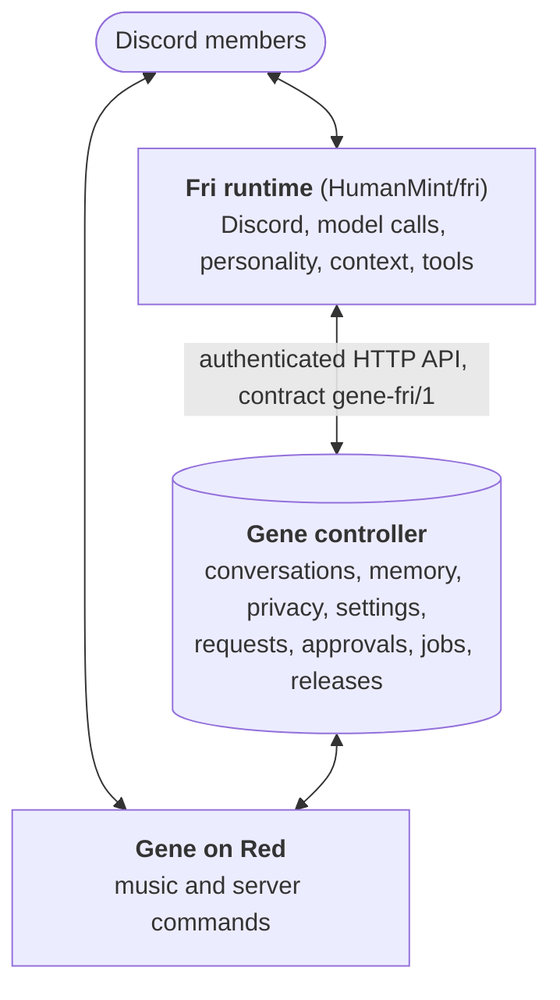

# Gene

Gene is the Discord bot and trusted controller behind
[Fri](https://github.com/HumanMint/fri), a companion bot for one friend server. It has
two parts:

- **Red cogs** (`cogs/`): Gene's own bot on upstream
  [Red-DiscordBot](https://github.com/Cog-Creators/Red-DiscordBot) 3.5.24, with music
  through Lavalink, meme highlights and the `/gene menu` panel. Red itself isn't forked.
- **The controller** (`src/gene/`, FastAPI + SQLite): stored conversations and memory,
  privacy controls, settings, member requests and owner approvals, jobs and releases.
  Fri has no database; everything it keeps goes through here. A coding worker, a
  deployer and the release tooling sit around it, and the controller is the only
  deployment authority.

**Try it:** the [quickstart](docs/quickstart.md) runs the controller locally in a few
commands, with no Discord account needed, then pairs it with a local Fri.



<details>
<summary>Plain-text version</summary>

```
Discord members
      ↕
Fri runtime: Discord, model calls, personality, context, tools
      ↕  authenticated controller API (contract gene-fri/1)
Gene controller: conversations, memory, privacy, settings, requests, approvals, jobs, releases
      ↕
Gene / Red: music and server commands
```

</details>

Fri checks the controller's `/fri/contract` and its capabilities at startup. A Fri change
that needs controller changes pins the Gene commit in Fri's `docs/integration-pair.json`;
Gene merges and releases first, then Fri. [Architecture](docs/architecture.md) has the
details.

## Quickstart

You need `git` and [uv](https://docs.astral.sh/uv/getting-started/installation/), which
fetches Python 3.11 if needed.

```sh
git clone https://github.com/HumanMint/gene.git
cd gene
uv sync --frozen
uv run python scripts/dev.py init        # .env.local from the template
uv run python scripts/dev.py token       # run once per service token and paste each into .env.local
uv run python scripts/dev.py check       # validate it and dry-run the controller, offline
uv run python scripts/dev.py controller  # http://127.0.0.1:8787
```

Then, in [the quickstart](docs/quickstart.md):

- **Pair with a local Fri**: add your test server's IDs to `.env.local` and give Fri the
  same values (`dev.py fri-env` prints them).
- **Add Gene's Red bot** (optional): `uv sync --frozen --extra red`, a bot token, then
  `dev.py red`.
- **Music** (advanced) needs a Red-compatible Lavalink node.

Real credentials come in only at those steps: a Discord bot token for each bot, and Fri's
model access on the Fri side. Installing on a server is [host installation](docs/setup.md).

## Features

- `/gene menu`: music and server tools with one private, reusable panel per member.
- Red's normal playback, queue, permissions, DJ checks and cooldowns.
- Meme voting and highlights with unique voters, self-vote exclusion and persistent IDs.
- Fri can run Gene's existing non-admin commands for a member, with the same permission
  checks. For music, join a voice channel before queuing a track.
- Owner-reviewed feature requests, isolated development, exact-commit releases, backups
  and code rollback. Verified automatic repairs stay within existing features.
- Optional audio services and an optional download relay. The relay only downloads and
  transfers files, then deletes its temporary copies; playback and the bounded media
  cache stay on the bot host.

## Repository layout

| Path | What |
| --- | --- |
| `cogs/` | Red extensions: the Gene panel and commands, meme highlights |
| `src/gene/` | controller, coding worker, deployer, Red integration, audio compatibility imports |
| `scripts/` | local development (`dev.py`), configuration, host install, audio and history tools |
| `ops/` | Dockerfiles, Compose files, systemd units, the maintainer release script |
| [red-audio-adapter](https://github.com/HumanMint/red-audio-adapter) (separate repository) | the Lavalink source plugin, audio services and playback probes |
| `tests/` | state, authorization, persistence, failure-recovery and feature tests |
| `docs/` | guides, listed below |

## Documentation

| Guide | For |
| --- | --- |
| [Quickstart](docs/quickstart.md) | running Gene locally, pairing with Fri, adding Red |
| [Architecture](docs/architecture.md) | the parts, service tokens, the Fri contract, jobs and releases |
| [Host installation](docs/setup.md) | operators: a production-style Linux install |
| [Operator runbook](docs/operations.md) | operators: production operations, audio, releases, recovery, privacy |
| [Maintainer release](ops/maintainer/batch-release.md) | operators: the Gene + Fri batch release script |
| [Fri migration](docs/fri-migration.md) | what moved to the Fri repository and what stays here |
| [Fri workspace](docs/fri-foundation.md), [Fri tool results](docs/fri-reliability.md) | Fri behaviour the controller backs: images, reminders, plans, receipts |
| [Feature notes](docs/features/) | notes for individual features |
| [Direction](docs/roadmap.md) | where the project is headed |
| [AGENTS.md](AGENTS.md) | rules for maintainers and coding agents |

## Development

```sh
uv sync --frozen --extra red
uv run --no-sync pytest -q
uv run --no-sync ruff check .
```

Tests run without credentials or network access. CI runs the same checks on pull
requests that change code.

The feature worker may change only `cogs/`, `tests/features/` and `docs/features/`. It
cannot change its own approvals, controller, dependencies or deployment code. New
Discord feature requests still need owner intake approval and exact-commit release
approval. The controller's existing-feature repair policy requires a proven baseline
failure, a frozen regression and independent reviews. Discord messages, imported history
and reactions never grant authority. User-facing success must be verified separately
from a healthy process or a queued track.

## Fri boundary

The current protocol is `gene-fri/1`, exposed only to Fri's credential at
`/fri/contract`. The Gene feature deployer only restarts Red; Fri uses a separate release
file and a maintainer-only coordinator, `gene.fri_release`.

Some `fri_*` modules remain active controller contracts and persistence. The old
companion implementation is retained temporarily as a compatibility/rollback
baseline; future companion features belong in the Fri repository. See
[ownership and migration](docs/fri-migration.md) for the precise boundary.

## Privacy

Tokens, auth sessions, raw history, databases and private context stay in ignored
private paths (`.env.local`, `.secrets/`, `.state/`) and never in Git. `gene forgetme
true` erases stored user context and cancels pending proposals; existing Discord and
GitHub messages, code and backups are separate records.

## Credits

Gene is maintained by [HumanMint](https://github.com/HumanMint). Its bot framework,
core command system and music features come from
[Red-DiscordBot](https://github.com/Cog-Creators/Red-DiscordBot), maintained by
[Cog Creators and Red's contributors](https://github.com/Cog-Creators/Red-DiscordBot/graphs/contributors).
Gene adds project-specific cogs, adapters and the trusted controller around the
upstream package.

Early implementation was developed with [OpenAI Codex](https://openai.com/codex/),
using GPT-6 Astra and GPT-6.1 Sol. Development continues with Codex and Claude:
Codex contributes code, tests and independent reviews; Claude contributes
implementation and integration work.

## License

Gene is licensed under the [GNU General Public License v3.0](LICENSE) (GPL-3.0-only).
Its cogs run on Red-DiscordBot, which is also GPL-3.0.
