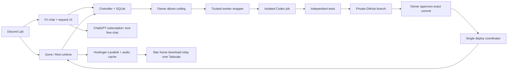

# Gene

Gene is a private Discord assistant for a friend server: classic Red commands and
music, meme highlights, and an owner-approved development loop for Discord requests.

**Current mode: invisible, Discord Lab only.** Gene handles music, meme highlights,
and the established Red functions. Fri is a separate bot for chat and development requests.
Both register commands only in the configured lab. Ordinary DMs stay disabled; only the
owner's approval buttons on Fri's own review DMs are accepted.

In **Discord Lab → #tests_n_stuff**, open `/gene` for music and server tools or `/fri`
for chat, requests, progress, and owner settings. Join a voice channel before adding music.
Each bot keeps one private panel per member, edits it in place, and provides Close.
Panels expire after ten minutes; old panels from before a restart may need dismissal.

Fri responds to explicit @mentions in the workshop and its threads, or privately through
**Chat with Fri**. She keeps the last six exchanges per person and conversation for up to
seven days. Public and private context are separate. **Forget my chats** clears this context;
shared server facts are added only through the owner's **Saved context** controls.

Fri can clarify an idea and offer a request draft. **Review and submit request** opens an
editable form. Submitting stores it as **awaiting owner review**, without starting code.
The owner then chooses **Allow coding** in Fri's DM or Requests panel. When a tested
proposal is ready, the same DM shows its summary, code link, and full SHA for separate
release approval. Progress and failure explanations update that DM too. Stale decisions
are rejected. Unavailable DMs never grant approval; the panel remains a fallback.

Chat has no tools or shell access. The controller owns approvals and deployment, and Gene's
service credential cannot access Fri's request, model, memory, or release endpoints.
This limits what a malicious message can trigger; the owner still reviews the resulting code.

## What is implemented

- Red 3.5.24 runtime with custom `gene` and `numbers` cogs.
- Owner intake approval, DM reviews, status, exact-commit release approval, rejection,
  pause, rollback, and usage.
- SQLite persistence, serialized jobs, distinct Gene/Fri/worker/deployer credentials.
- An isolated Codex CLI coding worker using a dedicated ChatGPT subscription login.
- Independent tests in a container with no credentials or network access.
- Automatic repairs from failed test/lint feedback, with usage recorded per attempt.
- Feature branches in this private repository; no automatic merge to `main`.
- Immutable cog releases, exact-commit approval for Discord requests, backups, health checks, and
  automatic code rollback when a release fails to reconnect.
- Explicit, inspectable server facts and bounded Fri conversation context. No passive collection.
- A resumable, redacted `#bot-commands` importer that produces evidence for review.
- Net meme voting with unique voters, self-vote exclusion, removal handling, and
  persistent highlight IDs.
- A Red-compatible Lavalink node on Hostinger. The Mac only downloads public YouTube
  audio on demand through its home connection and hands it over through a private
  Tailscale relay. It deletes temporary files after successful or interrupted transfers.
- Complete files and playback stay on Hostinger. Its persistent audio cache keeps tracks
  for seven days since last playback, evicts least recently used idle tracks at its byte
  cap, protects active playback, and reserves free host space. Red's metadata cache is
  unchanged. No personal cookies or YouTube login are used.

Red is an upstream package, not a fork. The Discord interface lives in `cogs/gene/panel.py`
and invokes Red's normal command pipeline for playback controls. Its queue screen reads
Red's player state and supplies buttons in place of reaction controls. The external source lives in `audio-plugin/`
and `src/gene/audio_resolver.py`; neither changes Red's installed code.

Uncached tracks and new searches depend on the Mac and source services. Cached tracks
can play by saved link while the Mac is offline. A successful search is
not proof of voice playback; queue and sustained playback must be checked in the lab.
History-derived settings are not applied until reviewed. Spotify integration and
infrastructure provisioning remain future work.

## Architecture



The coding job can change `cogs/`, `tests/features/`, and `docs/features/`. It cannot
publish its own release or change the trusted controller/deployer. Control-plane
and dependency changes go through a maintainer update. Candidate containers do not
receive GitHub, Discord, controller, host SSH, or deployment credentials. The coding
container receives its dedicated Codex authentication cache; tests receive none.

Changes and fixes the owner requests directly in this Codex chat can be tested,
committed, pushed, and deployed without another approval. They remain recorded by
exact commit with backups, health checks, and rollback protection. Discord-originated
requests, fixes, and repairs still require owner approval of the full commit SHA.
This maintainer policy does not add an approval bypass to Discord or the controller.

## Local development

```bash
uv sync --extra red
uv run --no-sync pytest -q
uv run --no-sync ruff check .
python3 scripts/configure.py
```

Python 3.11 is pinned by the project because this Red release requires Python below
3.12. Dependencies are recorded in `uv.lock`. Populated environment files, auth,
state, imported evidence, and audio configuration are ignored by Git.

Both chat and new coding jobs default to **GPT-6.1 Sol** (`gpt-6.1-sol`) with **high**
reasoning effort. `/fri → Owner settings` exposes separate Chat model and Coding model
selectors, catalog refresh, and Usage. Refresh discovers new choices without changing the
selected model. Each development job snapshots its model and effort.

Fri uses official **Sign in with ChatGPT** for a personal self-hosted VM. No OpenAI API key
is needed. The coding worker keeps its separate official Codex login to the subscription.
Usage records show chat and development input, cached input, output, and unknown attempts.
Cached input is part of input; reasoning is part of output. There is no app-imposed token
budget. These counts are not remaining plan quota; account limits still apply.

Create a separate Discord application named Fri with privileged intents off, then run:

```bash
uv run --no-sync python scripts/configure_fri.py
uv run --no-sync python scripts/connect_fri_chatgpt.py
```

The first verifies Fri's bot token and prints a Lab invite if needed. The second opens the
official subscription sign-in and privately saves a VM-bound renewable session for secure
transfer to Hostinger. See the operations guide before transferring or reconnecting it.
Never paste either token in chat or commit credentials.

`gene forgetme true` erases the caller's stored requests, chats, links and approved facts,
and cancels pending proposals. Discord/GitHub posts, code, and backups are separate records.

[Operations](docs/operations.md) covers startup, authentication, release recovery,
history import, privacy, and lab validation. [Roadmap](docs/roadmap.md) describes the
next iterations.
