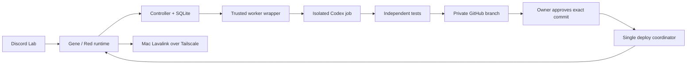

# Gene

Gene is a private Discord assistant for a friend server: classic Red commands and
music, meme highlights, and an owner-approved feature development loop.

**Current mode: invisible, Discord Lab only.** Gene starts offline in Discord's
presence list. Events from other servers and DMs are discarded before feature
handlers run. Workshop slash commands are registered only in the configured lab.
The original friend-server configuration stays in an ignored local file.

To try the current installation, use **Discord Lab → #tests_n_stuff**:

```text
!gene
```

`/gene menu` opens the same panel. Buttons open private music controls, request
forms, request progress and owner settings. Model and reasoning choices use dropdowns;
release approval shows and submits the exact commit under review. The home panel's
buttons survive restarts; personal menus expire after ten minutes and can be reopened.
Existing commands remain available. To try music, join a lab voice channel
and choose **Music → Add a track**. Meme votes in
`#tests_n_stuff` can highlight messages in `#tests_n_stuff-2` at a net score of five.
Gene stays invisible while responding to commands.

## What is implemented

- Red 3.5.24 runtime with custom `gene` and `numbers` cogs.
- Requests, status, exact-commit approval, rejection, pause, rollback, and usage.
- SQLite persistence, serialized jobs, distinct runtime/worker/deployer credentials.
- An isolated Codex CLI coding worker using a dedicated ChatGPT subscription login.
- Independent tests in a container with no credentials or network access.
- Automatic repairs from failed test/lint feedback, with usage recorded per attempt.
- Feature branches in this private repository; no automatic merge to `main`.
- Immutable, owner-approved cog releases, pre-release backups, health checks, and
  automatic code rollback when a release fails to reconnect.
- Explicit, inspectable server facts. No passive chat memory.
- A resumable, redacted `#bot-commands` importer that produces evidence for review.
- Net meme voting with unique voters, self-vote exclusion, removal handling, and
  persistent highlight IDs.
- A Red-compatible Lavalink node on the Mac mini, reachable only from the VPS over
  Tailscale. A separate source plugin delegates public YouTube extraction to a pinned
  `yt-dlp` resolver on loopback. No browser cookies or personal YouTube login are used.

Red is an upstream package, not a fork. The Discord interface lives in `cogs/gene/panel.py`
and invokes Red's normal command pipeline. The external source lives in `audio-plugin/`
and `src/gene/audio_resolver.py`; neither changes Red's installed code.

Music availability depends on the Mac and source services. A successful search is
not proof of voice playback; queue and sustained playback must be checked in the lab.
History-derived settings are not applied until reviewed. Fri, general AI chat,
Spotify integration, and infrastructure provisioning are later work.

## Architecture



The coding job can change `cogs/`, `tests/features/`, and `docs/features/`. It cannot
publish its own release or change the trusted controller/deployer. Control-plane
and dependency changes go through a maintainer update. Candidate containers do not
receive GitHub, Discord, controller, host SSH, or deployment credentials. The coding
container receives its dedicated Codex authentication cache; tests receive none.

## Local development

```bash
uv sync --extra red
uv run --no-sync pytest -q
uv run --no-sync ruff check .
python3 scripts/configure.py
```

Python 3.11 is pinned by the project because this Red release requires Python below
3.12. Dependencies are recorded in `uv.lock`. Populated environment files, auth,
state, imported evidence, and audio configuration are ignored by Git.

In the workshop, use `/gene request` or the configured prefix, for example:

```text
!gene request Add a small coin-flip command with a cooldown
!gene status <request-id>
!gene approve <request-id> <full-commit-sha>
!gene usage
!gene model
!gene models true
!gene model gpt-6-astra high
!gene remember The lounge is the default music channel
!gene memories
!gene forget <memory-id>
!gene pause true
!gene rollback
```

`gene approve`, usage, memory administration, pause, and rollback are owner-only.
`gene forgetme true` erases the caller's active request/context records and cancels
pending proposals. Backups and already-produced code are separate records; see the runbook.

The worker starts with **GPT-6 Astra** (`gpt-6-astra`) and its catalog default reasoning
effort. `gene models true` refreshes the account's Codex catalog between jobs;
`gene models` displays the models, supported efforts, and refresh time. `gene model`
shows or changes the selection. Each job snapshots its model and effort, and usage
is grouped by that model. New models never silently replace the chosen one; if the
selection disappears, coding waits for an owner decision. The catalog is discovery,
not a guarantee every inference request will be accepted by the provider.

[Operations](docs/operations.md) covers startup, authentication, release recovery,
history import, privacy, and lab validation. [Roadmap](docs/roadmap.md) describes the
next iterations and the future Gene/Fri split.
