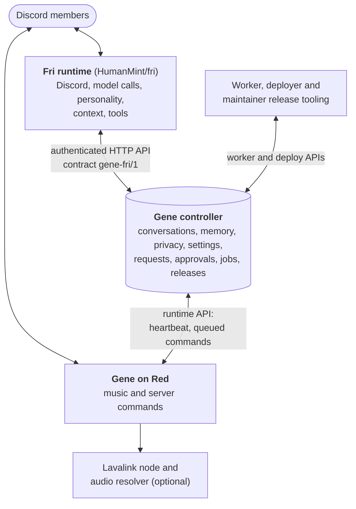

# Architecture

Gene and [Fri](https://github.com/HumanMint/fri) are two bots for one Discord server,
built as two repositories:

- **Fri** (`HumanMint/fri`) is the companion people talk to: a sassy but helpful friend
  in the server. Its runtime owns the Discord client, model calls, personality, context
  gathering (history, images, replies, threads, pins, links, reactions), tools and
  background attention. Fri has no database of its own.
- **Gene** (this repository) is two things:
  1. **Red cogs** (`cogs/`): Gene's own Discord bot on
     [Red-DiscordBot](https://github.com/Cog-Creators/Red-DiscordBot) 3.5.24, with music
     through Lavalink, meme highlights and the `/gene menu` panel.
  2. **The trusted controller** (`src/gene/`, FastAPI + SQLite): stored conversations and
     memory, privacy controls and revisions, settings, member requests and owner
     approvals, jobs and releases. Everything Fri keeps goes through it. A coding worker,
     a deployer and the maintainer release tooling (`ops/`) sit around it. The
     controller is the only deployment authority.



The same picture in plain text:

```
Discord members
      ↕
Fri runtime: Discord, model calls, personality, context, tools
      ↕  authenticated controller API (contract gene-fri/1)
Gene controller: conversations, memory, privacy, settings, requests, approvals, jobs, releases
      ↕
Gene / Red: music and server commands
```

Members also use Gene's own commands and `/gene menu` directly; that path doesn't
involve Fri.

## The controller

`src/gene/api.py` builds the FastAPI app. Every route except `/health` needs a bearer
token, and each service has its own:

| Token | Used by | For |
| --- | --- | --- |
| `GENE_FRI_TOKEN` | Fri | the `gene-fri/1` contract: context, memory, privacy, settings, requests, owner reviews, queued Gene commands |
| `GENE_RUNTIME_TOKEN` | Gene's Red bot | heartbeats, running the commands Fri queued, status, `forgetme` erasure |
| `GENE_WORKER_TOKEN` | coding worker | claiming approved feature and repair jobs, heartbeats, results, usage |
| `GENE_DEPLOY_TOKEN` | deployer | claiming approved releases and reporting the result |

The controller refuses to start unless the four tokens are distinct and at least 32
characters. Requests are also scoped to the configured server (`GENE_GUILD_ID`) and
chat channels, and owner actions to the configured owner (`GENE_OWNER_ID`).

State is one SQLite file (`GENE_DB`). The schema is created on first start. Raw chat is
kept briefly (recent turns expire after seven days), and erasure through the privacy
controls removes a member's stored context.

The main modules:

| Area | Modules |
| --- | --- |
| App, auth, storage | `api.py`, `config.py`, `store.py` |
| Fri's routes | `fri_agent_api.py`, `fri_workspace_api.py`, `fri_operation_api.py`, `fri_social_api.py`, `fri_mentions.py` |
| Fri's stores | `fri_*_store.py`, `fri_memory*.py`, `fri_context.py`, `fri_conversation.py`, `fri_pending.py`, `fri_research.py` |
| Gene commands Fri can run | `control_api.py`, `gene_controls.py`, `runtime_controls.py` |
| Jobs, reviews, releases | `worker.py`, `deploy.py`, `repair_*.py`, `reviews.py`, `policy.py`, `fri_release.py`, `maintenance.py` |
| Red integration and audio | `runtime.py`; `runtime_audio.py`, `audio_resolver.py` and `audio_relay_server.py` preserve imports for the separate [red-audio-adapter](https://github.com/HumanMint/red-audio-adapter) package |

Some older `fri_*` modules here are the companion as it ran before Fri moved to its own
repository, kept as a compatibility baseline.
[Fri migration](fri-migration.md) draws the exact line; new companion behaviour belongs
in the Fri repository.

## The contract with Fri

The protocol is `gene-fri/1` (`src/gene/fri_protocol.py`). At startup Fri reads
`GET /fri/contract` with its token, checks the protocol, the required capabilities and
that the controller is the deployment authority, and refuses to start on a mismatch. It
then sends `X-Fri-Contract: gene-fri/1` with every call; the controller answers 409 to
any other version. Optional capabilities let a newer Fri run against an older
controller.

A Fri change that needs a controller change pins the Gene commit in Fri's
`docs/integration-pair.json`. Gene merges and releases first, then Fri; rollbacks go in
the reverse order. Fri's `scripts/offline-checks.sh` runs Fri's integration tests
against that exact controller commit.

## Commands, jobs and releases

- **Gene commands from Fri.** Fri queues a command (play a track, say) with the
  controller; Gene's Red bot polls the queue, runs the command with the member's own
  permissions, and reports the result. Fri never controls Red directly.
- **Feature requests.** A member's request is stored, the owner approves it, and the
  coding worker implements it in an isolated container. Feature jobs may change only
  `cogs/`, `tests/features/` and `docs/features/`. The owner approves the exact commit
  before the deployer releases it; the deployer restarts only Red.
- **Automatic repairs** within existing features follow a stricter policy: a proven
  failing regression test, independent reviews, and rollback protection.
- **Maintainer releases** of Gene and Fri together use
  `ops/maintainer/batch-release.sh` ([its guide](../ops/maintainer/batch-release.md)).

Discord messages, imported history and reactions are untrusted evidence; they never
grant approval. The [operator runbook](operations.md) covers production.

## Where things live

| Path | What |
| --- | --- |
| `cogs/gene/`, `cogs/numbers/` | Red cogs: the Gene panel and commands, meme highlights |
| `src/gene/` | controller, worker, deployer, Red integration, audio compatibility imports |
| `scripts/` | local development (`dev.py`), setup and host install, audio and history tools |
| `ops/` | Dockerfiles, Compose files, systemd units, maintainer release script |
| [red-audio-adapter](https://github.com/HumanMint/red-audio-adapter) (separate repository) | the Lavalink source plugin, audio services and playback probes |
| `tests/` | state, authorization, persistence and failure-recovery tests |
| `docs/` | this guide, setup, operations, Fri boundary and feature notes |
